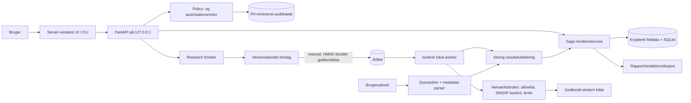

# ConsentOSINT — krav, trusselsmodel og arkitektur

**Status:** Godkendt af repository-ejeren 2026-10-14 — produktionskode afventer godkendelse af fase 1-implementeringsplanen  
**Dato:** 2026-10-14  
**Målrepository:** `chingchang2000/Osint-Tool` (`main`)  
**Repository-status:** Offentligt og tomt ved gennemgangen 2026-10-14

## 1. Formål og designintention

ConsentOSINT er et lokalt, samtykkebaseret arbejdsredskab til at dokumentere en persons eller organisations egen offentlige digitale eksponering. Produktets vigtigste egenskab er ikke bredest mulig søgning, men at hvert opslag er begrænset, forklarligt, autoriseret, reviderbart og kan slettes.

Værktøjet må kun bruges til:

1. brugerens egne oplysninger;
2. en person med udtrykkeligt, dokumenterbart samtykke;
3. en organisation, som brugeren ejer eller skriftligt må undersøge; eller
4. syntetiske testdata, der ikke repræsenterer virkelige personer.

En registreret erklæring er et kontrolpunkt, ikke et juridisk stempel. Brugerfladen og rapporterne skal konsekvent oplyse, at brugeren fortsat er ansvarlig for behandlingsgrundlag, formålsbegrænsning, GDPR/lokal ret, aftaler og kilders vilkår.

### Succes betyder

- En undersøgelse kan ikke oprettes eller bruges uden gyldigt autorisationsgrundlag, formål, tilladte datatyper, udløb og retention.
- Ingen ekstern tjeneste modtager data, før brugeren har set og godkendt præcis hvilke felter der sendes og hvorfor.
- Alle fund har kilde, tidspunkt, observation, usikkerhed og kendte konflikter.
- Rekursiv research er en begrænset kø af forslag, aldrig en autonom crawler.
- En hel sag og enkelte fund kan slettes; udløb håndhæves automatisk.
- En demonstration og hele testsuiten bruger kun syntetiske data og reserverede domæner.

### Ikke-mål og anti-mål

ConsentOSINT er ikke en personfinder, doxxinggenerator, overvågningsplatform, biometrisk tjeneste, relationskort over tredjepersoner eller adgangsværktøj til private konti. Det må ikke implementere realtidssporing, adresseindsamling uden strengt behov, familie-/venne-/følgergraf, ansigtsgenkendelse, følsomme inferenser, credential-angreb, phishing, ulovlige lækdatabaser, CAPTCHA-/betalingsmur-/adgangsomgåelse, automatiseret kontakt eller psykologiske/risikomæssige profiler.

## 2. Antagelser og åbne beslutninger

Alle punkter her er arkitektens antagelser og kan ændres ved godkendelsen.

| ID | Antagelse / foreslået standard | Hvorfor |
|---|---|---|
| A1 | Første version er en lokal, enkeltbruger-desktop/web-applikation bundet til `127.0.0.1`; ingen cloud-hosting eller fjernadgang. | Mindsker eksponering og identitets-/adgangskompleksitet. |
| A2 | UI er server-renderet Jinja2 + HTMX med progressiv JavaScript og en isoleret grafkomponent i fase 4. | Mindre build- og supply-chain-flade end en fuld React-SPA; stadig tilstrækkelig interaktivitet. |
| A3 | Python 3.12, FastAPI, Pydantic 2, SQLAlchemy 2, Alembic og SQLite i WAL-mode vælges. | Modent typed API/datalag, migrationskontrol og god lokal drift. |
| A4 | Kryptering i hvile bygger først på dokumenteret OS-diskkryptering plus feltkryptering med en nøgle i OS keyring. V1 må give en best-effort advarsel, men må ikke hævde at kunne håndhæve fulddiskkryptering. SQLCipher er ikke et v1-krav og vurderes som en senere distributionsprofil. | Standard-SQLite er ikke krypteret, og pålidelig tværplatformsverifikation af fulddiskkryptering er ikke realistisk i første version. |
| A5 | Ingen ekstern AI-model bruges i version 1; senere AI kræver en separat data disclosure og eksplicit opt-in pr. handling. | Rå persondata må ikke forlade enheden som standard. |
| A6 | Første version har kun førstepartsadaptere, registreret ved build-time. Dynamisk tredjepartskode er deaktiveret, indtil ægte proces-/netværksisolation er verificeret. | Et Python-interface alene er ikke en sikker sandbox. |
| A7 | Standardgrænser: dybde 2, højst 25 åbne forslag pr. sag, 2 samtidige jobs, 15 minutters samlet ekstern køretid pr. godkendelsesrunde og 100 MB lagret sagsdata. | Konkrete, konservative grænser kan testes og ændres af brugeren nedad; forhøjelse kræver advarsel. |
| A8 | Standardretention er 30 dage og den absolutte v1-maksimumgrænse er 180 dage. V1 har ingen administratoromgåelse; længere retention er en fremtidig, særskilt governance-funktion. | Understøtter dataminimering og fjerner en uklar enkeltbruger-privilegiegrænse. |
| A9 | En brugerinitieret URL må kun hentes fra kildens manifesterede domæner eller sagens verificerede domæner. Generel webcrawling er ude af scope. | Gør SSRF, scope og vilkår håndterbare. |
| A10 | Dansk og engelsk UI-tekst bør understøttes, men fase 1 kan levere engelsk intern domæneterminologi og dansk brugerflade. | Kravteksten er dansk, mens tekniske standardbegreber og biblioteker er engelske. |
| A11 | Auditloggen må ikke indeholde rå identifikatorer. Den gemmer interne ID'er, aktør, handling, policy-kode, kilde-ID og tidsstempel; en blokeret handling gemmer ikke det blokerede payload. | Bevarer revisionsværdi uden at gøre auditloggen til en sekundær persondatabase. |
| A12 | Licens vælges før første offentlige kodecommit; anbefalingen er Apache-2.0 med en separat Abuse and Safety Policy. | En licens styrer kodebrug; misbrugspolitikken styrer forventet anvendelse, men kan ikke alene forhindre forks. |
| A13 | DNS-adapteren har ingen skjult offentlig standardresolver. Brugeren vælger en navngivet DoH-endpoint eller en konkret organisationsresolver; systemresolveren kan kun vælges, hvis UI tydeligt kan vise dens konfigurerede destination og usikkerheden om eventuel upstream videresendelse. | Godkendelsesskærmen skal kunne oplyse, hvem der modtager domænenavnet. |
| A14 | Et `ApprovalSnapshot` serialiseres kanonisk og forsynes med HMAC sammen med manifest-hash, payload-hash, sag-ID og udløb. Worker validerer HMAC og aktuelle policyregler før kaldet. | En ID/hash-reference alene beskytter ikke mod lokal DB-manipulation og matcher ikke arkitekturens ord “signeret”. |

## 3. Kort kravspecifikation

### 3.1 Funktionelle krav

**R1 — Sag og autorisation.** En sag har ejer/aktør, formål, ét autorisationsgrundlag, tilladte datatyper, autorisationsudløb, retention, eventuel dokumentreference og en eksplicit bekræftelse. En sag er `draft`, `active`, `paused`, `expired`, `deleting` eller `deleted`. Eksterne jobs kræver `active` sag og gyldig autorisation på både godkendelses- og kørselstidspunktet.

**R2 — Input og normalisering.** Originalværdi og normaliseret repræsentation gemmes separat. E-mail splittes uden at ændre lokal-delens semantik; domæner normaliseres med IDNA/punycode og vises også i Unicode med homografadvarsel; telefoner normaliseres til E.164 kun ved forsvarligt landekontekst; navne tokeniseres forsigtigt uden vestlig navneantagelse; brugernavne forbliver separate identifikatorer. Import accepterer valideret CSV/JSON. Billeder analyseres kun for lokal metadata og filhash, ikke biometrik.

**R3 — Kilder.** Hver kilde har et versionsbundet manifest med juridiske/tekniske betingelser, input/outputskema, krævet autorisation, netværksdomæner, secrets, rate limit, timeout, cache-/retentionpolitik, risikoniveau, datakvalitet og teststatus. Adapteren modtager kun felterne i en godkendt request-envelope og returnerer strengt validerede observationer.

**R4 — Research frontier.** Et fund kan danne et forslag, aldrig et automatisk næste opslag. Forslaget viser input, modtager, formål, forventet informationsværdi, privatlivsrisiko og begrundelse. Brugeren kan godkende eller afvise. Godkendelsen er versionsbundet og HMAC-beskyttet mod det viste payload; ændres payload eller kildemanifest, kræves ny godkendelse.

**R5 — Bevis og forbindelser.** Systemet gemmer observationer og evidens, ikke endelige identitetsdomme. Relationer får status `confirmed`, `probable`, `possible`, `conflicting`, `rejected` eller `unknown`, med understøttende og modstridende signaler, kilder, tid og manuel status. Navn eller brugernavn alene kan aldrig løfte en relation over `possible`. Tillid vises som forklarlige kategorier, aldrig pseudo-præcise procenter.

**R6 — Stop, udløb og sletning.** Brugeren kan pause en sag og annullere køede jobs. Worker kontrollerer annullering og autorisationsudløb før netværkskald og før persistens. Retention-worker sletter udløbet sagsindhold. Selektiv sletning fjerner fund og afledte relationer/forslag. Hel sletning fjerner sagsdata og efterlader højst en ikke-personhenførbar systemkvittering.

**R7 — Rapport og eksport.** Rapporten adskiller dokumenterede observationer, manuelt bekræftede forhold, sandsynlige/mulige relationer, konflikter og mangler. Den indeholder omfang, kilder, søgeperiode, begrænsninger, blokerede/fravalgte handlinger og sletedato. Maskering er standard i delbar eksport. CSV-felter, der starter med `=`, `+`, `-`, `@`, tab eller carriage return, neutraliseres mod formula injection.

**R8 — Audit.** Oprettelse, autorisationsændringer, forslag, godkendelse, opslag, eksport, bekræftelse/afvisning, sletning og policy-afvisninger registreres uden rå PII. Append-only audit-events kædes kryptografisk, så manipulation kan detekteres. Audit-integritet er detekterende, ikke et løfte om uforanderlighed mod en lokal administrator.

**R9 — Misbrugsafvisning.** UI/API/CLI afviser forbudte handlinger med en stabil policy-kode, neutral forklaring og audit-event uden unødvendigt inputpayload. Produktet må ikke tilbyde en generisk vilkårlig crawler eller fri plugin-netværksadgang.

**R10 — UI.** Seks visninger: Ny undersøgelse, Oversigt, Bevis, Forbindelsesgraf, Næste opslag og Rapport/eksport. Alle grafdata skal også findes i en tastatur- og skærmlæserbar tabel. Kritiske handlinger kræver tydelig konsekvens og bekræftelse.

### 3.2 Ikke-funktionelle krav

- Sikker som standard: eksterne kilder deaktiveret, loopback-only, ingen telemetri, ingen rå PII i logs.
- Streng typing, schema-validering og database-migrationshistorik.
- Genoptagelige og idempotente jobs; crash må ikke medføre dobbelt eksternt opslag uden synlig status.
- Ensartede, ikke-lækkende fejl til klienten; detaljerede men PII-redigerede lokale diagnostiklogs.
- Tilgængelighedsmål: WCAG 2.2 AA for kerneflows i fase 4.
- Understøttede platforme foreslås som Windows 11, macOS 14+ og en aktuel LTS Linux; endelig matrix besluttes før fase 1.
- Alle automatiske tests bruger syntetiske identiteter, dokumenter og `example.com/.org/.net`.

### 3.3 Acceptkriterier for første brugbare version

1. En uautoriseret eller udløbet sag kan ikke foretage et opslag, heller ikke via direkte API-kald eller genoptaget job.
2. Et DNS/RDAP-opslag viser og binder godkendelsen til det præcise domæne og den eksterne modtager.
3. Hvert fund har provenance og usikkerhed; en relation opstår aldrig som bekræftet alene ved navn/brugernavn.
4. Stop, selektiv sletning, hel sletning og automatisk udløb er testet end-to-end.
5. SSRF-, upload-, XSS-, SQLi-, path traversal- og CSV-injection-tests består.
6. En syntetisk demo kan køres uden eksterne konti eller virkelige persondata.

## 4. Teknologivalg og alternativer

### Backend

**Anbefaling: Python 3.12 + FastAPI + Pydantic 2 + SQLAlchemy 2/Alembic.** Det giver eksplicitte schemas, typed servicegrænser og kontrollerede migrations. SQLModel er et legitimt alternativ med mindre boilerplate, men Pydantic-/ORM-grænser bliver mindre tydelige; her vægtes sikker validering og migrationskontrol højere. Django er et stærkt alternativ, især hvis flerbrugeradmin bliver et krav, men er større end nødvendigt for en loopback-only enkeltbrugerapp.

### UI

**Anbefaling: server-renderet Jinja2 + HTMX.** Det reducerer to build-økosystemer og holder autorisationslogik server-side. React + TypeScript giver bedre komponentøkosystem til grafen, men øger supply-chain-, state- og XSS-kompleksitet. Hvis fase 4 viser, at frontier/graf kræver klienttung interaktion, kan en afgrænset React-ø bruges uden at gøre hele produktet til en SPA.

### Lagring og kryptering

**Anbefaling: SQLite + SQLAlchemy/Alembic.** PostgreSQL er bedre til flerbruger/cloud og stærkere samtidighed, men strider mod local-first-MVP. Standard-SQLite krypterer ikke. Baseline er derfor fulddiskkryptering dokumenteret som driftskrav, feltkryptering for særligt følsomme værdier med versionsbundet AEAD og nøgle fra OS keyring samt en valgfri SQLCipher-build. Backup må aldrig kopiere dekrypterede felter.

### Jobafvikling

**Anbefaling: separat lokal worker med databasebaseret job-state machine.** FastAPI `BackgroundTasks` er ikke robust ved nedbrud. Celery/Redis er unødvendigt tungt lokalt. Jobtabellen bruger idempotency key, lease, retry-budget og `queued/approved/running/succeeded/failed/cancelled/expired`.

### Pakning

Lokal Python-installation er udviklerbaseline. Docker er valgfri og må kun binde loopback samt montere en eksplicit datamappe. En signeret desktop-pakke kan vurderes efter fase 5; den må ikke skjule database-, keyring- eller netværksadfærd.

## 5. Foreslået systemarkitektur

### 5.1 Tillidsgrænser

1. **Bruger → lokal API:** Selv en lokal klient er utroværdig. Alle regler håndhæves i service-/policy-laget, ikke kun i UI.
2. **API → database/keyring:** Databasen kan stjæles; hemmelige felter krypteres separat, og nøgle opbevares ikke i databasen.
3. **Worker → netværk:** Adaptere må ikke selv åbne vilkårlige sockets. En broker validerer scheme, normaliseret host, DNS-resultater før og efter redirect, IP-klasser, port, domæneallowlist, redirectantal, timeout, bytegrænse og MIME.
4. **Ekstern tekst → system:** Web-/API-indhold er data, aldrig instruktioner. Det må ikke ændre policy, værktøjskald eller AI-prompts. HTML sanitiseres og vises som tekst/allowlistet markup.
5. **Upload → parser:** Filen placeres uden for webroot med genereret navn, størrelse/type valideres ud fra magic bytes, arkiver og aktive formater afvises i MVP, og parser kører med ressourcegrænser i separat proces.
6. **Adapter → kerne:** Resultater accepteres kun gennem et versioneret schema. Ukendte felter afvises eller isoleres; de persisteres ikke automatisk.
7. **Rapport → modtager:** Eksport er en ny disclosure. Brugeren ser felter, maskering og format før generering; hver eksport auditeres.

### 5.2 Komponentansvar

- **Policy/Authorization:** validerer grundlag, scope, udløb, datatype, source policy, retention og forbudte formål før forslag, godkendelse, kørsel og persistens.
- **Case service:** ejer transaktioner for seeds, entities, observations, evidence og relations.
- **Frontier:** deduplikerer forslag, beregner forklarlige kategorier og håndhæver dybde/antal/tid/størrelse.
- **Job worker:** udfører kun signerede/versionsbundne godkendelser, håndterer timeout/retry/cancel og gemmer provenance.
- **Network broker:** eneste outbound HTTP/DNS-vej for plugins; håndhæver egress-policy og redirection rebinding-kontrol.
- **File analyzer:** udtrækker en eksplicit allowlist af metadata; gemmer ikke originalfilen efter analysen, medmindre brugeren aktivt vælger retention.
- **Report service:** redaktion, provenance, begrænsninger og sikre eksportformater.
- **Retention service:** daglig sweep plus kontrol ved opstart; sletter kaskader og verificerer fravær.

### 5.3 Domænemodel

Kerneobjekter:

- `Case`, `AuthorizationRecord`, `Purpose`, `RetentionPolicy`
- `SeedInput` med `original_value`, typed `normalized_value` og klassifikation
- `Entity` (navnevariant, e-mail, telefon, brugernavn, domæne, website, profil, organisation, repository, dokument, filmetadata)
- `Observation` (kildens direkte udsagn) og `Evidence` (provenance, timestamp, source URL, excerpt/hash, freshness)
- `Relation` med status, matchende/modstridende signaler, begrundelse og manuel beslutning
- `SearchProposal`, `ApprovalSnapshot`, `SearchJob`
- `SourceManifest`, `SourceRun`, `AuditEvent`, `ExportRecord`, `DeletionReceipt`

Observationer er immutable; rettelser bliver nye observationer eller en manuel beslutning. Relationer er vurderinger oven på observationer. Denne adskillelse gør det muligt at bevare modstridende evidens uden at omskrive historien.

### 5.4 Forsigtig korrelation

Tilladte signaler er eksakte verificerede links, selvlænker mellem profiler, verificeret fælles domæne, offentligt selverklæret organisation med støtte, tidsmæssig konsistens og verificerbart ejerskab/signatur. Filhash kan kun fastslå byteidentitet, ikke personidentitet.

Kategorier foreslås sådan:

- `confirmed`: manuel bekræftelse eller direkte verificerbart ejerskab/link uden uløste konflikter.
- `probable`: mindst to uafhængige, ikke-følsomme signaltyper og ingen væsentlig konflikt.
- `possible`: ét svagt signal eller utilstrækkelig uafhængighed.
- `conflicting`: mindst ét væsentligt modsignal.
- `rejected`: manuel afvisning eller verificeret modbevis.
- `unknown`: utilstrækkelige observationer.

Koden skal gemme de konkrete regler og signaler, ikke et skjult numerisk scorefelt. Alternative forklaringer (navnesammenfald, genbrugte handles, organisationskonti, forældede profiler) vises aktivt.

## 6. Plugin- og kildeinterface

Et source-manifest deklarerer mindst: ID/version, udvikler, beskrivelse, tilladte inputtyper, outputskema, netværksdomæner og ports, hemmeligheder, krævet autorisation, rate limit/backoff, timeout, maksimal respons, cache/retention, risikoniveau, manuel godkendelse, vilkårs-/kildelink, kendte begrænsninger og teststatus.

Kernen sender en minimal, eksplicit `ApprovedSourceRequest` med sag-ID, proposal-ID, inputfelter, formålskode, tidsbegrænsning og manifest-hash. Adapteren får ikke en database-session. Den returnerer `SourceResult` med observationer, direkte links, hentetid, kvalitet, warnings og fejlklasse. Netværk går gennem brokeren.

Førstepartsadaptere kan køre i worker-processen i de første faser. Tredjepartsadaptere kræver før aktivering: separat OS-proces, read-only kodepakke, ingen database-/keyring-/filesystem-adgang, egress kun via broker, signerede pakker eller lokal trust-beslutning, SBOM, pinned dependencies og kontrakttests. Et pluginmanifest er ikke i sig selv en sandbox.

## 7. Lovlige og realistiske datakilder

Dette er teknisk/governance-design, ikke juridisk rådgivning. Vilkår skal genverificeres før hver adapterrelease.

| Kilde | Beslutning | Betingelser og begrænsninger |
|---|---|---|
| Lokal filmetadata | **Fase 2** | Kun brugerupload; allowlist af passive filtyper og metadatafelter; ingen ansigtsanalyse; original slettes som standard efter extraction. |
| DNS | **Fase 2** | Kun autoriserede domæner; standard record-typer; resolver/timeouts/rate limits; resultat er teknisk observation, ikke ejerskabsbevis alene. |
| RDAP via IANA bootstrap | **Fase 2** | Find autoritativ RDAP-base via IANA-registret; respekter registry-vilkår, redaktion og rate limits; gem ikke irrelevante kontaktfelter. IANA publicerer DNS bootstrap-registret og JSON-endpointet.[1] |
| Eksakt offentligt website | **Sen fase 2/3, begrænset** | Kun kendt/verificeret domæne og bruger-godkendt URL; robots/vilkår respekteres; ingen crawl, JS eller login; tekst behandles som utroværdig. |
| GitHub REST API | **Valgfri fase 3+** | Kun offentlig profil/repository, helst eksakt kendt URL eller selvlænke; ingen følger-/stjerne-/social graf og ingen kontaktudledning. GitHub tillader unauthenticated public-data requests med lavere rate limit (aktuelt 60/time) og har særskilte brugs-/privacy-regler.[2][3] |
| HIBP | **Valgfri fase 3+ efter særskilt review** | Kun selv-/samtykkebaseret e-mail eller verificeret organisationsdomæne. API-key/User-Agent kræves for e-mail/domæne; domænesøgning kræver dokumenteret domænekontrol. Gem kun breach-navn/tid/provenance, aldrig passwords eller stealer-log-rådata i MVP.[4] |
| Virksomhedsregistre | **Ikke generisk i MVP** | Én jurisdiktion pr. adapter efter vilkårs- og feltreview; kun organisationssager; undgå personkontaktfelter, medmindre nødvendige og autoriserede. |
| Generel søgemaskine | **Manuelt link i MVP** | Ingen skjult scraping. Google Custom Search JSON API er ikke tilgængelig for nye kunder og står til ophør 2027-01-01; Bing Search APIs blev udfaset 2025-08-11. Derfor ingen automatisk generel søgning i baseline.[5][6] |
| Certificate Transparency | **Udskudt** | Kan afsløre subdomæner og historik; kræver kilde-/vilkårsvalg, scope- og dataminimeringsreview. DNS/RDAP er tilstrækkeligt til fase 2. |
| Datamæglere/lækdatabaser | **Forbudt** | Ingen køb, scraping eller ulovligt fremskaffede datasæt. |

GDPR-principperne om data minimisation og storage limitation understøtter de foreslåede scope- og retentiongrænser; konkret behandlingsgrundlag og rollefordeling skal dog vurderes for den faktiske bruger og jurisdiktion.[7]

## 8. Trusselsmodel

### 8.1 Aktiver og modstandere

**Aktiver:** autorisationsdokumentation, startdata, observationer/relationer, API-nøgler, krypteringsnøgler, auditlog, eksporter og brugerens lokale session.

**Modstandere/misbrugere:** en legitim bruger med stalking-/doxxingformål; malware eller anden lokal bruger; ondsindet ekstern kilde; kompromitteret plugin/dependency; ekstern angriber mod en fejlkonfigureret lokal service; og en velmenende bruger, der drager falske identitetskonklusioner.

### 8.2 Trusler og kontroller

| Trussel | Risiko | Forebyggelse / detektion | Resterende risiko |
|---|---|---|---|
| Stalking eller falsk samtykke | Kritisk | Scope-formular, udløb, formåls-/datatypebegrænsning, ingen autonomous crawl/social graf/adresse/realtid, godkendelse pr. disclosure, policy-afvisning og audit. | En bruger kan lyve; software kan ikke verificere alle juridiske relationer. |
| Doxxing/ukontrolleret eksport | Kritisk | Maskering som standard, eksplicit eksportpreview, begrænset format, watermark/limitations, audit, ingen “find alt”-rapport. | Autoriseret lokal bruger kan kopiere synlige data manuelt. |
| Uautoriseret lokal API-adgang | Høj | Loopback-only, tilfældig sessionhemmelighed i keyring, SameSite/HttpOnly/Secure-when-applicable cookies, CSRF-token, Origin-check, kort session, rate limit. | Malware i samme brugerkontekst kan omgå app-grænser. |
| Database-/backup-tyveri | Høj | Fuld disk encryption som driftskrav, felt-AEAD, keyring-separation, ingen plaintext-backup, korte retentioner, secure permissions. | En oplåst kompromitteret maskine kan læse gennem appen. |
| Lækkede API-nøgler | Høj | Keyring/env, aldrig DB/kode/log, least-scope tokens, redaction, startup secret scan, rotationsvejledning. | Kilden kan logge requests; bruger må forstå disclosure. |
| Ondsindet webindhold / prompt injection | Høj | Indhold er typed data, ingen agentinstruktioner, ingen ekstern AI i v1, HTML sanitization/escaping, CSP, direkte kildelink markeres ekstern. | Social engineering i indhold kan stadig påvirke brugeren. |
| SSRF/DNS rebinding/redirect | Kritisk | Central broker; kun HTTPS undtagen DNS/RDAP-behov; block loopback/private/link-local/multicast/metadata/IP literals; resolve+pin/validate hvert hop; allowlist; maks redirects; ports; timeouts; size/MIME. | Komplekse DNS/CDN-scenarier kan give false positives; allowlist vedligeholdes. |
| XSS | Høj | Autoescape, ingen rå HTML, sanitizer for nødvendige excerpts, CSP uden inline script, safe URL schemes, dependency review. | Browser-/library-zero-days. |
| SQL injection | Høj | SQLAlchemy-parametrisering, ingen dynamisk SQL fra source fields, allowlisted sort/filter keys, tests. | Rå SQL migrations kræver review. |
| Path traversal | Høj | Genererede UUID-filnavne, ingen brugersti i filesystem, resolve-and-containment checks, private data dir. | Parser-fejl/OS edge cases. |
| Farlige uploads / parser exploit | Kritisk | Magic-byte/type/size checks, afvis arkiver/macros/executables, quarantine, separat lavprivilegeret proces, CPU/memory/time limit, patched parsers, slet original. | Native parser-zero-days; derfor minimal formatliste. |
| CSV/formula injection | Høj | Prefix risikoceller med apostrof, UTF-8, dokumenter ændringen, test tabs/CR og alle farlige præfikser. | Importprogrammer kan have andre fortolkninger; anbefal JSON til fuld fidelity. |
| Supply-chain-angreb | Høj | Lockfile med hashes, Dependabot/scanning, SBOM, minimale dependencies, pinned CI actions by SHA, provenance/signering før release. | Upstream compromise før detektion. |
| Overdreven logning | Høj | Struktureret allowlist logging, PII-redaction, ingen bodies/URLs med query, logtests og kort retention. | Nye felter kan omgå redaction; schema-default er drop. |
| Plugin overskrider rettigheder | Kritisk | Ingen tredjepartsplugins i MVP; ingen DB-handle; brokered network; process isolation; schema + manifest hash. | Python/OS-sandbox er platformafhængig og skal penetrationstestes. |
| Identitetskollision / falsk konklusion | Høj | Navn/handle alene utilstrækkeligt, modbevis påkrævet i modellen, forklarlige kategorier, manuel bekræftelse, alternative forklaringer, freshness. | Mennesker kan overvurdere sandsynlige relationer; UI-copy og træning er nødvendig. |
| Auditmanipulation | Middel | Append-only sekvens, forrige-event-hash + HMAC, verifikationskommando, separat keyring-nøgle, deletion receipt. | Lokal administrator kan ændre både data og runtime; ekstern notarization er ikke ønsket pga. privacy. |
| Race: samtykke udløber under job | Høj | Kontrol ved approve, dequeue, før netværk og før commit; resultater kasseres/minimeres ved udløb og event auditeres. | Et allerede sendt request kan ikke trækkes tilbage. |
| Forældede/korrupte kildedata | Høj | Hentetid, kilde-URL, freshness flag, konfliktbevarelse, ingen “ingen resultater = findes ikke”. | Kilden kan være fejlagtig; rapporten skal sige det. |

### 8.3 Sikkerhedsregler for URL-hentning

- Parseren accepterer kun absolutte URL'er med tilladt scheme, ingen credentials og normaliseret IDNA-host.
- Host skal matche manifest-/sagsallowlist efter normalisering; suffixmatch må ikke acceptere lookalike-domæner.
- DNS A/AAAA kontrolleres mod forbudte ranges; destinationen valideres igen for hvert redirect.
- Maks. 3 redirects, 10 sekunders connect og 20 sekunders total timeout som foreslået standard.
- Maks. 5 MB respons og kun deklarerede MIME-typer; streaming afbrydes ved grænsen.
- Ingen browser/JavaScript i MVP. En senere browseradapter kræver separat threat model, container og manuel godkendelse.
- Rate limits er både kilde-specifik token bucket og global saggrænse; `Retry-After` respekteres uden identitets-/IP-rotation.

## 9. Faseinddeling og gates

Hver fase afsluttes med testresultat, kendte begrænsninger, syntetisk-data/PII-scan og brugerens godkendelse før næste større fase.

### Fase 0 — Beslutningsgate (dette dokument)

- Godkend scope, antagelser, platformmatrix, licens, retention/grænser og arkitektur.
- Leverance: godkendt designspecifikation; derefter skrives en detaljeret TDD-implementeringsplan.

### Fase 1 — Sikker lokal kerne

- Projektstruktur og dependency policy.
- Datamodel/migrations, lokal sag, autorisationsflow og policy engine.
- PII-minimeret, integritetskontrolleret auditlog.
- Krypterings-/keyring-abstraktion, retention/sletning og syntetiske fixtures.
- API/CLI-basics uden eksterne opslag.
- Tests: uautoriseret/udløbet sag, CRUD, auditintegritet, logs, sletning/udløb, direct-API bypass.

**Gate:** Ingen eksterne netværkskald findes; sikkerhedsreview af authorization invariants.

### Fase 2 — Kontrollerede inputs og første kilder

- E-mail-, telefon-, domæne-, navn- og username-normalisering med originalbevarelse.
- Importvalidering og sikker lokal filmetadataanalyse.
- Source manifest/adapterkontrakt og central netværksbroker.
- DNS og RDAP for autoriserede domæner; provenance og caching.
- Tests: IDNA/homografer, tvetydige telefoner, SSRF/rebinding/redirects, uploads, timeouts, rate limit og API-fejl.

**Gate:** Red-team-test af broker/upload og review af RDAP-feltminimering/vilkår.

### Fase 3 — Research frontier og evidens

- Versionsbundne forslag/godkendelser, begrænsninger og job-worker.
- Entity/observation/evidence/relation, konflikter og alternative forklaringer.
- Forklarlige tillidskategorier og manuel confirm/reject.
- Valgfri GitHub/HIBP-adapter kun efter separat kilde-/privacy-review.
- Tests: race ved udløb, idempotency, resume/cancel, recursion limits, plugin isolation, identitetskollisioner og modstridende beviser.

**Gate:** Misbrugsreview med stalking-/doxxing-scenarier og dokumenteret egressoversigt.

### Fase 4 — Brugerflade og rapporter

- De seks UI-visninger, stop alle opslag og accessible evidence table.
- Begrænset graf som supplement, ingen tredjepersonudvidelse.
- Redigerede rapporter, datafortegnelse, JSON/CSV med injection-beskyttelse.
- Playwright journeys, tilgængelighedskontrol og XSS/CSP-tests.

**Gate:** Brugertest med udelukkende syntetiske sager; eksport/privacy-review.

### Fase 5 — Hærdning og distribution

- Verifikation af threat model, dependency/SBOM/scanning, performance og crash recovery.
- Dokumentation: formål, lovlig scope, abuse policy, installation, konfiguration, kilder, secrets, privacy, samtykke, sletning, eksport, fejlfinding og adapterudvikling.
- Docker som valgfri installation; pakke-/signeringsbeslutning; backup/restore-test.
- Sluttest og PII-/secret-scan på repository, fixtures, artifacts og logs.

**Gate:** Definition-of-done check og eksplicit releasegodkendelse.

## 10. Teststrategi

- **Unit:** normalizers, policy predicates, correlation rules, redaction, CSV safety, URL/IP validation og schemas.
- **Property-based:** IDNA/URL/telefon/importgrænser, log-redaction og frontier caps.
- **Contract:** hver source-adapter mod gemte syntetiske svar og manifestversion.
- **Integration:** API + SQLite + worker med fake network broker; ingen live persondata.
- **Security regression:** SSRF, DNS rebinding, XSS, SQLi, traversal, upload/polyglot, formula injection, secret/PII logs.
- **End-to-end:** Playwright for create/authorize/propose/approve/run/review/export/delete.
- **Failure/recovery:** timeout, 429, malformed responses, crash efter request før commit, idempotent resume og consent expiry races.

CI må som standard blokere outbound network. Live contract-tests er manuelle, anvender kun officielle testkonti/reserverede domæner og må aldrig køre på pull requests fra forks med secrets.

## 11. Dokumentation og produkttekst

Repository skal mindst få `README`, `SECURITY`, `PRIVACY`, `ABUSE_AND_SAFETY`, `DATA_SOURCES`, `PLUGIN_DEVELOPMENT`, `THREAT_MODEL`, backup/sletning og bidragsvejledning. Rapporter bruger konsekvent formuleringer som:

- “Følgende offentligt tilgængelige oplysninger blev observeret i de valgte kilder.”
- “Undersøgelsen er ikke udtømmende.”
- “Manglende resultater er ikke bevis for, at oplysningerne ikke findes.”
- “En mulig sammenhæng er ikke en bekræftet identitet.”
- “Kilden kan være forældet eller fejlagtig.”

## 12. Godkendte produktbeslutninger

Repository-ejeren godkendte 2026-10-14 designet med de foreslåede standarder:

1. V1 er local-first, enkeltbruger og loopback-only.
2. UI bygges server-renderet med Jinja2/HTMX; en isoleret grafkomponent kan tilføjes i fase 4.
3. Grænserne i A7 og retention på 30 dage/absolut 180 dage anvendes.
4. Krypteringsprofilen, HMAC-bundne godkendelser og resolvermodellen i A4 og A13–A14 anvendes.
5. Brugerfladen er dansk-first og localization-ready; intern domæneterminologi er engelsk.
6. Koden licenseres under Apache-2.0 med en separat Abuse and Safety Policy.
7. Udviklerbaseline er lokal Python 3.12 på Windows 11, macOS 14+ og aktuel LTS Linux; Docker er valgfri i fase 5, og en signeret desktop-pakke vurderes senere.
8. DNS og RDAP er v1-kildescopet. GitHub og HIBP forbliver valgfrie fase-3+-kandidater efter særskilt privacy-/kildereview og er ikke releasekrav.

Næste artefakt er den fil-for-fil TDD-implementeringsplan for fase 1. Fase 1 må først implementeres efter særskilt godkendelse af den plan.

## 13. Kilder

1. [IANA RDAP DNS Bootstrap Registry](https://www.iana.org/assignments/rdap-dns)
2. [GitHub REST API rate limits](https://docs.github.com/en/rest/using-the-rest-api/rate-limits-for-the-rest-api)
3. [GitHub Acceptable Use Policies](https://docs.github.com/en/site-policy/acceptable-use-policies/github-acceptable-use-policies)
4. [Have I Been Pwned API v3](https://haveibeenpwned.com/API/v3)
5. [Google Custom Search JSON API overview and retirement notice](https://developers.google.com/custom-search/v1/overview)
6. [Microsoft: Bing Search APIs retired 2025-08-11](https://learn.microsoft.com/en-us/lifecycle/announcements/bing-search-api-retirement)
7. [EU GDPR consolidated text, Article 5 principles](https://eur-lex.europa.eu/legal-content/EN/TXT/PDF/?uri=CELEX%3A02016R0679-20160504)

